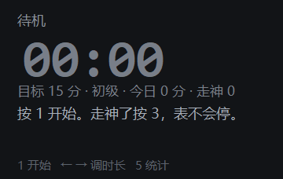
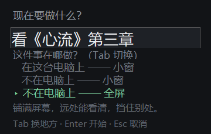
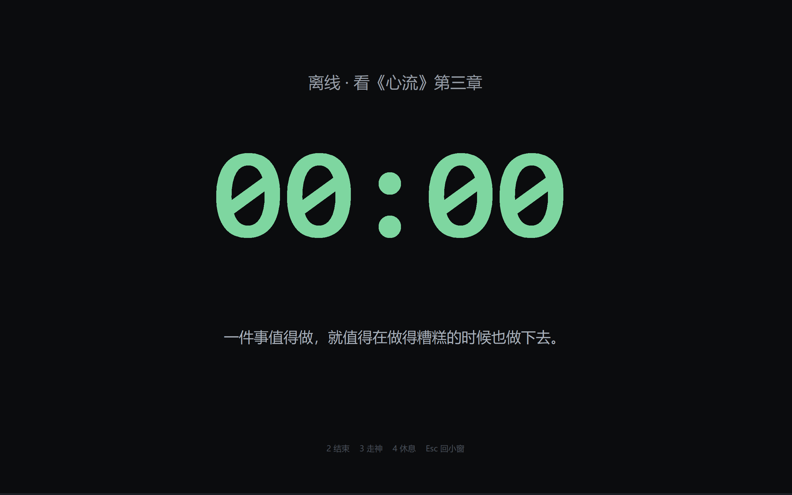
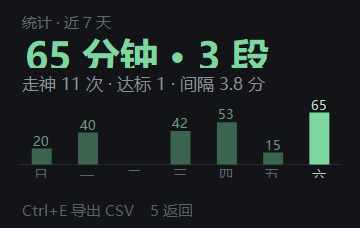

# FocusKeeper 专注计时器

一个键盘驱动的 Windows 专注计时器。为「坐得住、但容易飘」的人做的：开始之后你只需要记得三个键，剩下的它来兜底。

单文件、零依赖、本地运行，不上传任何数据。

| 主界面 | 标题与载体选择 | 全屏形态 | 统计 |
|---|---|---|---|
|  |  |  |  |

## 它是怎么工作的

| 键 | 作用 |
|---|---|
| `1` | 开始（写一句现在要做什么；顺便选「这件事在不在电脑上做」） |
| `2` | 结束 |
| `3` | 走神 —— **计时不会停**，只记一笔，屏幕上给一句安慰 |
| `4` | 休息 —— 随机放自带钢琴曲（CC-BY，可换成 data\music\ 里的自己的曲子） |
| `5` | 统计 |
| `↑` `↓` | 开始前直接换等级：初级 15 分 / 中级 25 分 / 高级 45 分 |
| `←` `→` | 开始前微调目标分钟（等级按时长自动跟着变） |
| `M` | 休息音乐 开/关 |
| `Tab` | 开始前切换载体：电脑上小窗 / 离开电脑小窗 / 离开电脑全屏 |
| `F11` | 专注中随时切换小窗 / 全屏 |
| `Ctrl+E` | 导出 CSV |

## 设计取舍

**走神是零惩罚的。** 按 `3` 没有任何扣分、变红或"失败"提示。原因很直接：一旦走神有代价，人就不按了，数据当天就变成废纸。这个工具的价值全在数据真实上。

**核心指标不是总时长，是走神间隔中位数。** 总时长只证明你坐了多久；相邻两次走神之间的间隔从 4 分钟变成 7 分钟，才是真的进步。统计页里那个数字值得长期盯。

**计时器假设你会忘事。** 到点没按结束会提醒，再等几分钟没动静就按目标时长自动收工（时长截到目标，宽限期不算专注）；6 分钟没动键鼠按"离开"结束；锁屏、合盖同理。反过来说：你在离开电脑的状态下（看书、写字）计时，它不会因为你没碰键盘就判定你消失了。

**不做连续打卡。** 断一天就清零的机制，惩罚的恰恰是"回归"，只会让人破罐破摔。看本周总量就够了。

**时长建议交给数据，不交给感觉。** 每次打开和收工后，工具按最近几次（14 天内）的表现建议今天的时长：连续达标且走神不密就加 10 分钟（上限 60），连续没到目标就减 5 分钟（下限 10），单次表现不算数。建议都会带上理由，不同意随时用 `↑↓` `←→` 改。

**待机时显示「今日一句」。** 都是书里有出处的话（庄子、荀子、苏轼、胡适、里尔克、村上春树……），每天换一条。没有鸡汤，没有网红语录，每一条都能查到原文。

**休息是循环的一部分，不是中断。** 专注到点响一声，默认**直接进休息**（可右键菜单或 `settings.json` 的 `autoBreak` 改成按 `4` 确认）：初级 3 分 / 中级 5 分 / 高级 10 分（休息长度和专注长度是配套的，短专注配长休息只会让人走神）。休息时随机放**自带的免费钢琴曲**（4 首，Kevin MacLeod 作品，CC-BY 4.0，署名见 `music\LICENSES.txt`；曲子播完自动换下一首）。想听自己的？右键菜单「上传我自己的音乐…」挑文件（会复制进 `data\music\`），你的曲子优先，自带的就不播；曲库全空时退回程序合成的棕噪雨声。倒计时走完还有 2 分钟缓冲，音乐继续放，屏幕大字等你回来；缓冲期内按 `1`，音乐停，新一轮专注开始，周而复始；缓冲期也没人回来，说明人走了，自动按目标时长收工。

## 下载

到 [Releases](../../releases) 页面下载 `专注计时器-便携版.zip`，解压后双击 `FocusKeeper.exe`。

- 自带运行时，目标机器不需要安装任何东西（64 位 Windows）
- 数据存在 exe 旁边的 `data\` 文件夹里，纯文本，拷走文件夹就是搬家

## 构建

需要 .NET 9 SDK：

```bash
dotnet build
dotnet publish -c Release -r win-x64 --self-contained true \
  -p:PublishSingleFile=true -p:EnableCompressionInSingleFile=true -o app
```

回归测试（74 项，覆盖状态机、休息循环、存储修复、截断一致性、文案规范、时长推荐、合成音频、曲库优先级）：

```bash
app/FocusKeeper.exe --selftest
```

## 反馈

这个工具首先是为我自己做的，我每天都在用，所以它不会烂尾。

它肯定有 bug，也肯定有我做错的设计判断——发现了请直接提 issue，不用组织语言，也不用客气。能站住脚的意见会变成下个版本，bug 一般当天修。

比起 star，我更想要一个正确的产品。直接说哪里不对就行。

---

# FocusKeeper (English)

A keyboard-driven focus timer for Windows, built for people who can sit down but drift. Once you start, you only need three keys; the app handles the rest.

Single file, zero dependencies, fully local — nothing leaves your machine.

| Main | Title & mode | Fullscreen | Stats |
|---|---|---|---|
|  |  |  |  |

## How it works

| Key | Action |
|---|---|
| `1` | Start (type what you're doing; pick whether the task lives on this PC) |
| `2` | Stop |
| `3` | Distract — **the timer keeps running**, it just logs the lapse with a line of comfort |
| `4` | Break — plays a random bundled piano track (CC-BY; swap with your own files in data\music\) |
| `5` | Stats |
| `↑` `↓` | Switch level directly before starting: Beginner 15 / Intermediate 25 / Advanced 45 min |
| `←` `→` | Fine-tune goal minutes before starting |
| `M` | Toggle break music |
| `Tab` | Cycle mode before starting: on-PC window / off-PC window / off-PC fullscreen |
| `F11` | Toggle window / fullscreen any time while focusing |
| `Ctrl+E` | Export CSV |

## Design choices

**Distraction carries no penalty.** Pressing `3` never deducts anything, never turns red, never counts as "failure". The reason is blunt: the moment distraction has a cost, people stop reporting it, and the data becomes fiction that same day. This tool is worth exactly as much as its data is honest.

**The core metric is median distraction interval, not total time.** Total minutes only prove you sat there. When the median gap between lapses grows from 4 to 7 minutes, that is actual progress. That's the number worth watching on the stats page.

**The timer assumes you forget things.** Miss the stop key and it reminds you; stay silent a few minutes longer and it auto-closes at the goal duration (grace time is truncated, never counted as focus). Six minutes of no input ends the segment as "away"; so do lock screen and sleep. Conversely, when you work away from the PC (reading, writing), it won't declare you gone just because you stopped typing.

**No streaks.** A counter that resets after one missed day punishes exactly the people who come back. Weekly totals are enough.

**Duration advice comes from data, not vibes.** On every launch and after every session, the tool suggests today's goal from your recent record (last 3 sessions within 14 days): all achieved with sparse distractions → +10 minutes (cap 60); all missed → −5 (floor 10); a single session never changes anything. Every suggestion comes with its reason, and `↑↓` `←→` always has the final say.

**Break is part of the loop, not an interruption.** When a segment hits its goal, a chime sounds and by default the break starts immediately (right-click menu or `autoBreak` in `settings.json` switches back to press-`4`-to-confirm): 3 min for Beginner / 5 for Intermediate / 10 for Advanced — break length pairs with focus length. The break randomly plays one of the **4 bundled royalty-free piano tracks** (Kevin MacLeod, CC-BY 4.0; credits in `music\LICENSES.txt`; when a track ends the next one starts automatically). Drop your own audio files in via the right-click menu (Upload my own music…, they are copied into `data\music\`) and yours take priority — bundled tracks are skipped; if no files exist anywhere, it falls back to synthesized brown noise. After the countdown a 2-minute grace period begins with the music still on. Press `1` during the grace period and a new focus segment starts; if nobody returns, the session auto-closes at the goal cap.

### Music credits

| Track | Composer / Performer | License |
|---|---|---|
| Gymnopedie No 1 | Erik Satie, perf. Kevin MacLeod | CC-BY 4.0 |
| Meditation Impromptu 02 | Kevin MacLeod | CC-BY 4.0 |
| Deliberate Thought | Kevin MacLeod | CC-BY 4.0 |
| Peace of Mind | Kevin MacLeod | CC-BY 4.0 |

Source: [incompetech.com](https://incompetech.com/music/royalty-free/music.html) · license: [CC-BY 4.0](https://creativecommons.org/licenses/by/4.0/)

**A "line of the day" while idle.** Every quote shown has a checkable source (Zhuangzi, Xunzi, Su Shi, Hu Shih, Rilke, Murakami...). No chicken soup, no influencer quotes — each one traces back to its original text.

## Download

Grab `专注计时器-便携版.zip` from the [Releases](../../releases) page, unzip, run `FocusKeeper.exe`.

- Self-contained — the target machine needs nothing installed (64-bit Windows)
- Data lives in `data\` next to the exe, plain text; moving the folder moves your history

## Build

Requires the .NET 9 SDK:

```bash
dotnet build
dotnet publish -c Release -r win-x64 --self-contained true \
  -p:PublishSingleFile=true -p:EnableCompressionInSingleFile=true -o app
```

Regression tests (74 checks covering the state machine, the break loop, storage repair, truncation consistency, phrase rules, goal recommendation, synthesized audio, and music library priority):

```bash
app/FocusKeeper.exe --selftest
```

## Feedback

I built this for myself first, and I use it every day — so it won't be abandoned.

It certainly has bugs, and certainly some design calls I got wrong. If you find one, open an issue directly: no need to phrase it carefully, no need to be polite. Reasonable feedback becomes the next version, and bugs are usually fixed the same day.

I care more about a correct product than about stars. Just tell me what's wrong.
